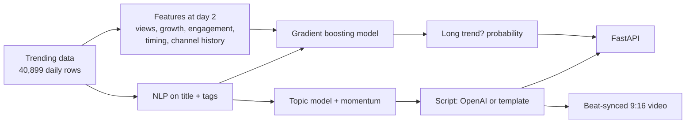
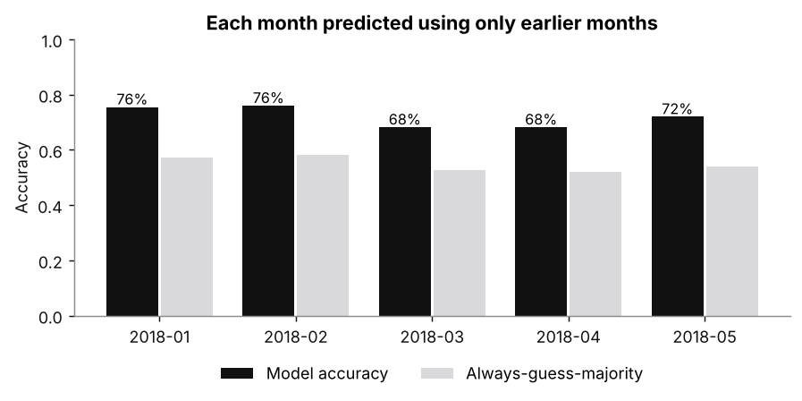
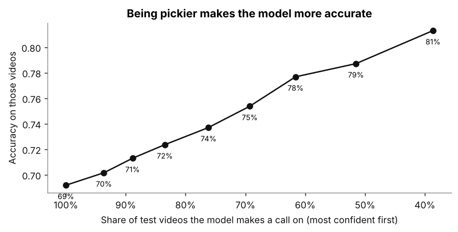
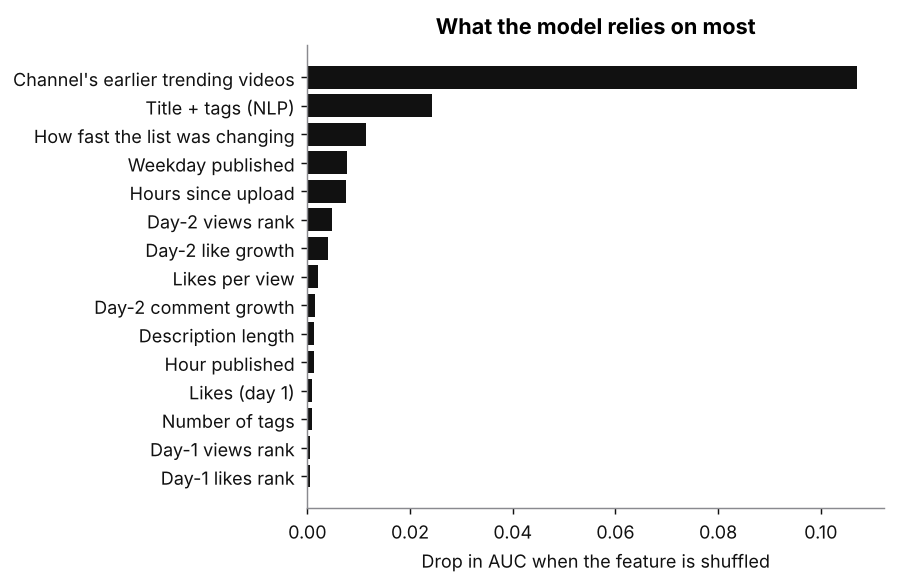
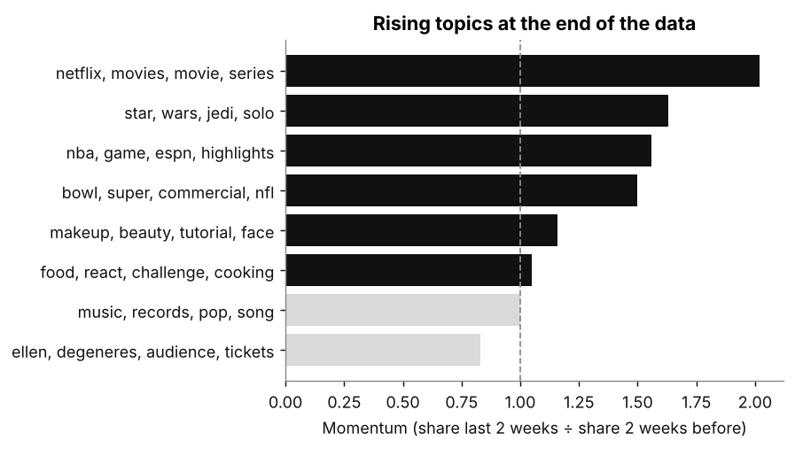

# Viral Trend Predictor & Video Automator

**Predicts which trending YouTube videos will stay trending, spots topics that are rising, and turns the top topic into a ready-to-post vertical video, all in Python.**


<p align="center">
  
  <br><sub>Generated automatically: rising topic → script → 9:16 video with a beat-synced soundtrack (<a href="assets/demo.mp4">MP4 with sound</a>)</sub>
</p>

---

## What it does

| Step | What happens | Tech |
|---|---|---|
| 1. **Predict** | At the end of a video's 2nd day on the trending list, estimate whether it will stay trending longer than the other videos that started that week | pandas, TF-IDF + SVD (NLP), gradient boosting |
| 2. **Spot topics** | Group trending titles and tags into topics and measure which ones are growing | TF-IDF + NMF topic modelling |
| 3. **Write** | Turn the top rising topic into a short hook → 3 points → call-to-action script | OpenAI API (optional) or a built-in template |
| 4. **Edit** | Render a 720×1280 vertical video; every cut and text animation lands on the beat of a generated soundtrack | Pillow, NumPy audio synthesis, MoviePy |
| 5. **Serve** | `/predict` and `/script` endpoints with interactive docs | FastAPI |



## Results

Tested the honest way: the model is always trained on the **past** and tested on the **future**, never on shuffled data.

**Main test:** trained on Nov 2017 to Mar 2018, tested on Apr to Jun 2018 (1,149 unseen videos).

| Metric | Score |
|---|---|
| Accuracy | **69.2%** (always guessing the most common answer gets 52.0%) |
| ROC-AUC | **0.76** |
| Accuracy on its most confident 62% of calls | **77.7%** |
| Accuracy on its most confident 39% of calls | **81.3%** |

**Month by month** (each month predicted using only the months before it):

| Month | Videos | Accuracy | AUC | Majority-guess baseline |
|---|---|---|---|---|
| Jan 2018 | 1,238 | 75.5% | 0.84 | 57.4% |
| Feb 2018 | 1,059 | 76.0% | 0.85 | 58.1% |
| Mar 2018 | 692 | 68.2% | 0.77 | 52.7% |
| Apr 2018 | 534 | 68.2% | 0.75 | 51.9% |
| May 2018 | 543 | 72.0% | 0.80 | 54.0% |

<p>
  
  
</p>
<p>
  
  
</p>

**What I learned from the results**

- **Channel track record matters most.** Channels that have trended before (music labels, late-night shows) tend to stay on the list longer.
- **The words in the title and tags are the second strongest signal.** Topic matters, not only view counts.
- **The trending list itself changes over time.** In spring 2018 videos started staying on the list longer, which silently broke a first version of the model. Comparing each video only with videos from **the same week**, and adding a "how fast is the list changing" feature, fixed it.
- **Use the confidence score.** When the model is very sure, it is right about 4 times out of 5.

> **Note:** this is a public, reproducible rebuild of a project from my CV. The original used different data and set-up. These numbers come from strict past-to-future testing on a public dataset, so they are lower than the 85% from my original version and they can be checked by anyone.

## Quick start

```bash
git clone https://github.com/m-shahmeer-kz/viral-trend-predictor.git
cd viral-trend-predictor
pip install -e ".[dev]"

python scripts/download_data.py      # get the public dataset (~60 MB)
trendpredictor train                 # test the model, save charts + model (~30 s)
trendpredictor topics                # print rising topics
trendpredictor video                 # make assets/demo.mp4 for the top topic
pytest -q                            # 13 tests
```

Optional: put an OpenAI key in your environment (`export OPENAI_API_KEY=...`, see `.env.example`) and install `pip install -e ".[llm]"`. The script step then uses GPT instead of the template. Without a key everything still works.

## API

```bash
uvicorn trendpredictor.api:app --reload
# open http://127.0.0.1:8000/docs to try it in the browser
```

```bash
curl -X POST http://127.0.0.1:8000/predict -H "Content-Type: application/json" -d '{
  "title": "NBA Finals Game 4 Highlights", "tags": ["nba", "highlights"],
  "publish_time": "2018-06-08T03:00:00Z", "first_trending_date": "2018-06-09",
  "day1": {"views": 850000, "likes": 9000, "dislikes": 300, "comment_count": 2100, "views_pct": 0.8},
  "day2": {"views": 1900000, "likes": 16000, "dislikes": 500, "comment_count": 3500, "views_pct": 0.9}
}'
# {"probability_long_trend": 0.535, "verdict": "likely long trend"}
```

Or with Docker: `docker build -t trend . && docker run -p 8000:8000 trend`

## How the prediction works

1. **Data:** the US file of the public [Trending YouTube Video Statistics](https://www.kaggle.com/datasets/datasnaek/youtube-new) dataset (CC0): about 200 trending videos per day, 14 Nov 2017 to 14 Jun 2018, 6,351 different videos.
2. **Target:** *does this video stay on the trending list longer than the median video that started trending the same week?* Videos from the first and last week are left out, because their full trending time can't be seen.
3. **Features (only things known at the end of day 2):** views, likes, dislikes and comments; how much they grew from day 1 to day 2; rank against that day's other trending videos; likes and comments per view; views per hour since upload; upload hour and weekday; title length and CAPS; number of tags; the channel's earlier trending videos; and how fast the list was changing during the previous week.
4. **NLP:** title + tags → TF-IDF (single words and word pairs) → 40 SVD components.
5. **Model:** `HistGradientBoostingClassifier` (scikit-learn).
6. **Testing:** a time split plus forward chaining, as shown above. A unit test checks that the channel-history feature never counts future videos.

## Project structure

```
src/trendpredictor/
  data.py      load the CSV, one row per video, features + label
  model.py     NLP + gradient boosting, honest time-based evaluation
  topics.py    topic model and rising-topic momentum
  script.py    OpenAI script with template fallback
  video.py     Pillow scenes + synthesized beat + MoviePy render
  plots.py     charts in reports/figures
  api.py       FastAPI service
  cli.py       `trendpredictor train | topics | video`
scripts/download_data.py
tests/         13 pytest tests (pipeline, no look-ahead, API)
reports/       metrics.json, charts, top predictions, rising topics
assets/        demo video + GIF
```

## Limitations

- The data covers the US list from 2017–2018, so the patterns may not fit today's YouTube or other platforms.
- It predicts how *long* a video stays trending, not whether a brand-new upload will trend at all.
- The generated video is a rough cut built from text scenes, not a finished edit with footage.

## Author

**Muhammad Shahmeer**: Data Science MSc student (University of Naples Federico II), Associate AI Engineer.
[Portfolio](https://m-shahmeer-kz.github.io/) · [LinkedIn](https://www.linkedin.com/in/muhammad-shahmeer-337088338) · [GitHub](https://github.com/m-shahmeer-kz)

Released under the MIT License.
